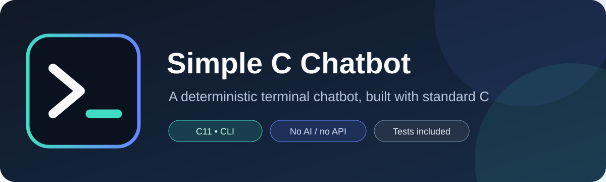
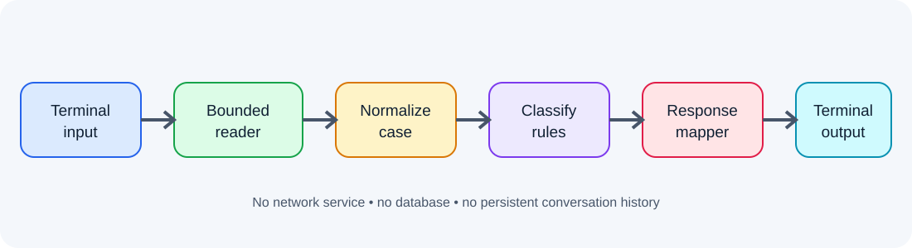
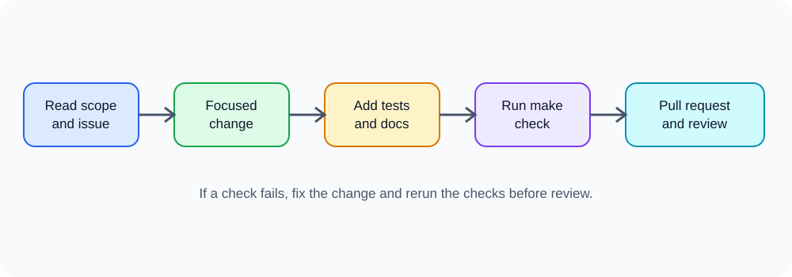

  

<h1 align="center">💬 Simple C Chatbot</h1>

  
  
  
  
  
  
  
  
  
  
  

> A small, deterministic, rule-based command-line chatbot written in standard C. **This is not an AI or LLM application.** It runs locally, uses fixed phrase rules, makes no network requests, and does not save conversation history.

## 📑 Table of Contents
- [🎯 Overview](#-overview)
- [❓ Problem and solution](#-problem-and-solution)
- [✨ Features and differentiators](#-features-and-differentiators)
- [🏗️ Architecture and workflows](#-architecture-and-workflows)
- [🧰 Technology stack](#-technology-stack)
- [🚀 Installation and usage](#-installation-and-usage)
- [⚙️ Configuration](#-configuration)
- [🧪 Testing and quality](#-testing-and-quality)
- [🗂️ Project structure](#-project-structure)
- [🔐 Security, privacy and accessibility](#-security-privacy-and-accessibility)
- [⚠️ Scope and limitations](#-scope-and-limitations)
- [📚 Documentation and templates](#-documentation-and-templates)
- [❓ FAQ](#-faq)
- [🤝 Contributing](#-contributing)
- [🗺️ Roadmap](#-roadmap)
- [🙏 Acknowledgements](#-acknowledgements)
- [📄 License and author](#-license-and-author)

## 🎯 Overview

Simple C Chatbot demonstrates a terminal conversation loop using C11. It reads one line, normalizes byte values to lowercase, evaluates ordered phrase rules, and prints a fixed response. It is intended for learners exploring arrays, functions, enums, strings, standard I/O, control flow, and defensive input handling.

## ❓ Problem and solution

A quick classroom example can hide input-read failures, overlong-line fragmentation, unsafe character conversion, and accidental exit behavior. This implementation separates line reading, normalization, classification, and response mapping. It checks input-read results, rejects overlong lines as one logical message, and exits cleanly on EOF.

## ✨ Features and differentiators

### Core features
- 🗣️ Interactive terminal conversation.
- 🔤 Case-insensitive byte-oriented phrase matching.
- 👋 Greeting and status responses.
- 🚪 Exact normalized bye command exits; goodbye does not.
- 🧱 Bounded input with a maximum accepted line of 255 bytes.
- 🧯 Long-line draining and graceful EOF handling.
- 🧪 C unit tests and POSIX shell integration tests.

### Engineering features
- 🧰 Strict C11 Makefile build and test targets.
- 🐧 Linux and 🪟 Windows source-build CI.
- 🔎 CodeQL and GCC static analysis.
- 📚 Extensive technical documentation and architecture decision records.
- 🧩 Reusable feature, architecture, QA, security, release, and maintenance templates.
- 🖼️ Original SVG visual identity and technical diagrams.

### Unique selling points
- No third-party runtime package installation.
- No network connection or API key required.
- Small source footprint and deterministic behavior.
- Clear examples of input boundaries and C string handling.
- Easy to compile and inspect without a framework.

## 🏗️ Architecture and workflows

### High-level system design

### Application architecture

### End-to-end workflow

### Input and error-handling flow

### Runtime rule flow
~~~mermaid
flowchart TD
 A[Start] --> B[Prompt and read line]
 B --> C{EOF or input error?}
 C -->|Yes| D[Clean exit]
 C -->|No| E{Overlong?}
 E -->|Yes| F[Drain remainder and warn]
 F --> B
 E -->|No| G[Normalize case]
 G --> H{Contains hello?}
 H -->|Yes| I[Greeting]
 H -->|No| J{Contains how are you?}
 J -->|Yes| K[Status]
 J -->|No| L{Exact bye?}
 L -->|Yes| M[Goodbye and exit]
 L -->|No| N[Fallback]
 I --> B
 K --> B
 N --> B
 M --> D
~~~

### Rule priority
| Priority | Condition | Response | Continues? |
|---:|---|---|---|
| 1 | Input contains hello after lowercasing | Greeting | Yes |
| 2 | Input contains how are you | Status | Yes |
| 3 | Entire normalized input equals bye | Goodbye | No |
| 4 | No rule matches | Fallback | Yes |

A message containing both hello and bye triggers the first rule and continues. This precedence is deliberate and covered by tests.

## 🧰 Technology stack

| Area | Technology | Purpose |
|---|---|---|
| Language | C11 | Program implementation |
| Runtime | C standard library | Character conversion, I/O, string operations |
| Build | Makefile and C compiler | Build application and tests |
| Unit tests | C assertions | Helper and rule verification |
| Integration tests | POSIX shell and awk | Real stdin/stdout behavior on Linux |
| CI | GitHub Actions | Linux/Windows build checks |
| Static analysis | CodeQL and GCC analyzer | Source-level analysis |
| Documentation | Markdown, Mermaid, SVG, Python standard library | Technical guides and validation |

No frontend framework, backend server, database, model provider, cloud service, package manager, or third-party C runtime library is used by the application.

## 🚀 Installation and usage

### Requirements
A C11 compiler such as GCC, Clang, or MinGW-w64. GNU Make and Python 3 are recommended for the full local quality gate. The application itself does not need Python.

### Linux/macOS
~~~sh
git clone https://github.com/Brajesh31/chatbot-C-.git
cd chatbot-C-
make
./build/chatbot
~~~

### Windows with MinGW-w64
~~~powershell
gcc -std=c11 -Wall -Wextra -Wpedantic -Werror chatbot/chatbot.c -o chatbot-build.exe
.\chatbot-build.exe
~~~

### Direct compilation
~~~sh
cc -std=c11 -Wall -Wextra -Wpedantic -Werror chatbot/chatbot.c -o chatbot
./chatbot
~~~

### Example conversation
~~~text
Chatbot: Hi! I'm a simple chatbot. Type 'bye' to exit.
You: hello
Chatbot: Hello! How can I help you today?
You: how are you?
Chatbot: I'm just a program, but thanks for asking!
You: bye
Chatbot: Goodbye! Have a great day!
~~~

The tracked chatbot/chatbot.exe is a historical Windows binary. Prefer building from the current source for the target platform.

## ⚙️ Configuration

There is no runtime configuration file and the program reads no environment variables. Phrase rules, input capacity, and response strings are defined in the C source. The root .env.example exists only to state that no environment variables are currently required.

Build flags may be overridden through Make, for example:

~~~sh
make CC=clang
make CFLAGS="-std=c11 -Wall -Wextra -Wpedantic -Werror -g"
~~~

There are no API keys, database credentials, or service URLs to configure.

## 🧪 Testing and quality

Run the local quality gate:

~~~sh
make check
~~~

Individual targets:
~~~sh
make
make test
make docs-check
make markdown-check
make structure-check
make security-check
make clean
~~~

Tests cover greeting/status/fallback rules, case normalization, exact exit behavior, empty input, EOF, and long-line handling. Linux CI runs the interactive shell suite. Windows CI compiles the application and C unit tests with MinGW. Documentation validation checks local links and SVG assets. Repository quality scripts check Markdown fences, tree accuracy, and common secret patterns.

No numeric coverage percentage, performance benchmark, or formal security certification is claimed. See [test strategy](docs/test-strategy.md), [end-to-end tests](docs/e2e-testing.md), and [known limitations](docs/scope-and-limitations.md).

## 🗂️ Project structure

The repository contains **248 tracked files** across source code, documentation, tests, automation and governance. The complete file-level tree is available below and in [docs/project-structure.md](docs/project-structure.md).

Expand complete tracked file and directory inventory (248 files)

~~~text
chatbot-C-/
.editorconfig
.env.example
.gitattributes
.github/
  dependabot.yml
  DISCUSSION_TEMPLATE/
    announcements.yml
    ideas.yml
    questions.yml
  ISSUE_TEMPLATE/
    accessibility_report.yml
    bug_report.yml
    config.yml
    documentation.yml
    feature_request.yml
    performance_issue.yml
    security_report.yml
  PULL_REQUEST_TEMPLATE.md
  README.md
  workflows/
    ci.yml
    codeql.yml
    dependency-review.yml
    docs-validation.yml
    lint.yml
    release.yml
    security-scan.yml
.gitignore
ACKNOWLEDGEMENTS.md
AUTHORS.md
CHANGELOG.md
chatbot/
  .vscode/
    settings.json
  chatbot.c
  chatbot.exe
CITATION.cff
CODE_OF_CONDUCT.md
CODEOWNERS
CONTRIBUTING.md
DISCLAIMER.md
docs/
  access-control.md
  accessibility-audit.md
  accessibility-guidelines.md
  accessibility-testing.md
  accessibility.md
  accessible-components.md
  accessible-forms.md
  api-authentication.md
  api-errors.md
  api-reference.md
  api-testing.md
  api.md
  application-lifecycle.md
  architecture-decisions.md
  architecture.md
  assets/
    application-state.svg
    architecture-overview.svg
    chatbot-flow.svg
    ci-pipeline.svg
    cli-sequence.svg
    data-flow-level0.svg
    data-flow-level2.svg
    data-flow.svg
    deployment-flow.svg
    error-handling.svg
    logo.svg
    project-banner.svg
    README.md
    response-priority.svg
    screenshots/
      README.md
    security-architecture.svg
    security-boundaries.svg
    system-design.svg
    testing-workflow.svg
    workflow-diagram.svg
  audit-logging.md
  authentication.md
  authorization.md
  backup-and-restore.md
  branding-guidelines.md
  bug-reporting.md
  building.md
  ci-cd.md
  cli-sequence.md
  cli-ux-guidelines.md
  code-standards.md
  coding-guidelines.md
  color-contrast.md
  commands-reference.md
  compatibility.md
  compliance.md
  component-architecture.md
  configuration.md
  consent-management.md
  contributor-guide.md
  cookie-policy.md
  data-deletion.md
  data-dictionary.md
  data-flow.md
  data-privacy.md
  data-protection.md
  data-retention.md
  data-validation.md
  database-schema.md
  database.md
  debugging.md
  decision-log.md
  decisions/
    0001-standard-c-console.md
    0002-bounded-line-input.md
    README.md
  dependencies.md
  dependency-security.md
  deployment-scope.md
  deployment.md
  deprecation-policy.md
  design-patterns.md
  developer-guide.md
  development-workflow.md
  development.md
  disaster-recovery.md
  e2e-testing.md
  encryption.md
  environment-setup.md
  environment-variables.md
  error-handling.md
  external-dependencies.md
  faq.md
  feature-scope.md
  features.md
  functional-requirements.md
  getting-started.md
  github-actions.md
  glossary.md
  incident-response.md
  installation.md
  integration-testing.md
  integrations.md
  keyboard-navigation.md
  known-issues.md
  legal-considerations.md
  limitations.md
  local-development.md
  logging.md
  maintainer-guide.md
  maintenance.md
  migration-guide.md
  module-documentation.md
  non-functional-requirements.md
  operations.md
  performance-testing.md
  performance.md
  privacy.md
  problem-statement.md
  product-overview.md
  project-background.md
  project-objectives.md
  project-status.md
  project-structure.md
  qa.md
  quality-gates.md
  README.md
  references.md
  release-management.md
  responsible-use.md
  risk-register.md
  roadmap.md
  rollback.md
  running-locally.md
  scalability.md
  scope-and-limitations.md
  screen-reader-support.md
  secret-management.md
  security-architecture.md
  security-best-practices.md
  security-risk-register.md
  security-testing.md
  security.md
  solution-overview.md
  system-design.md
  technical-debt.md
  technical-overview.md
  technology-stack.md
  templates/
    accessibility-audit-template.md
    adr-template.md
    api-documentation-template.md
    architecture-template.md
    benchmark-template.md
    bug-report-template.md
    change-request-template.md
    code-review-template.md
    compatibility-matrix-template.md
    database-schema-template.md
    deployment-checklist.md
    feature-proposal-template.md
    feature-specification-template.md
    incident-report-template.md
    maintenance-checklist.md
    meeting-notes-template.md
    migration-template.md
    project-status-template.md
    qa-test-case-template.md
    README.md
    release-checklist-template.md
    release-checklist.md
    risk-assessment-template.md
    rollback-checklist.md
    security-audit-template.md
    security-review-template.md
    test-plan-template.md
    test-report-template.md
    threat-assessment-template.md
    user-feedback-template.md
  test-coverage.md
  test-plan.md
  test-strategy.md
  testing.md
  third-party-services.md
  threat-assessment.md
  threat-model.md
  troubleshooting.md
  ui-ux-guidelines.md
  unit-testing.md
  upgrade-guide.md
  usage.md
  use-cases.md
  user-journeys.md
  user-personas.md
  versioning.md
  visual-regression-testing.md
  vulnerability-management.md
  wcag-compliance.md
  webhooks.md
  workflow.md
GOVERNANCE.md
LICENSE
MAINTAINERS.md
Makefile
README.md
ROADMAP.md
scripts/
  check_project_structure.py
  README.md
  release-check.sh
  security_check.py
  security-check.sh
  setup.ps1
  setup.sh
  validate_docs.py
  validate_markdown.py
SECURITY.md
SUPPORT.md
tests/
  README.md
  test_chatbot.c
  test_interactive.sh
~~~

## 🔐 Security, privacy and accessibility

The program uses bounded input and does not persist or transmit chat messages. It has no account, network, database, or secret-management subsystem. The plain-text interface avoids color-only meaning. SVG documentation assets include title and description metadata.

This is not a formal security audit, WCAG conformance statement, or accessibility certification. Build from reviewed source when binary provenance matters. Read [SECURITY.md](SECURITY.md), [threat assessment](docs/threat-assessment.md), [data privacy](docs/data-privacy.md), and [accessibility audit](docs/accessibility-audit.md).

## ⚠️ Scope and limitations

This project has no natural-language understanding, model, memory, personalization, language detection, GUI, voice support, database, HTTP API, authentication, webhooks, or remote service. Responses are fixed and may be irrelevant. Matching is substring-based and input is limited to 255 bytes. There is no hosted demo or deployment endpoint.

See [scope and limitations](docs/scope-and-limitations.md), [known issues](docs/known-issues.md), and [roadmap](ROADMAP.md).

## 📚 Documentation and templates

Start with the [documentation index](docs/README.md). Important guides:
- [Product overview](docs/product-overview.md)
- [Project objectives and requirements](docs/project-objectives.md)
- [System design](docs/system-design.md)
- [API/function reference](docs/api-reference.md)
- [Installation and getting started](docs/getting-started.md)
- [Usage examples](docs/usage.md)
- [Development workflow](docs/development-workflow.md)
- [Testing and QA](docs/testing.md)
- [Security architecture](docs/security-architecture.md)
- [Privacy and data handling](docs/data-privacy.md)
- [CI/CD and releases](docs/ci-cd.md)
- [Templates index](docs/templates/README.md)
- [Visual assets index](docs/assets/README.md)

## ❓ FAQ

**Is this powered by AI?** No. It uses a few deterministic phrase checks and fixed response strings.

**Does it need an internet connection?** No runtime internet connection is required.

**Does it store chat history?** No. The application does not persist conversation content.

**Why does goodbye not exit?** Only exact normalized bye is an exit command. The goodbye string is not equal to bye.

**What is the maximum input length?** 255 bytes per line in the current 256-byte buffer.

**Does it have a graphical interface or API?** No. It is a terminal program.

More answers are in [docs/faq.md](docs/faq.md).

## 🤝 Contributing

Read [CONTRIBUTING.md](CONTRIBUTING.md), [CODE_OF_CONDUCT.md](CODE_OF_CONDUCT.md), and [the contributor guide](docs/contributor-guide.md). Use the issue forms for bugs, features, documentation, accessibility, and performance reports. Keep changes focused, tested, portable, and project-specific.

## 🗺️ Roadmap

See [ROADMAP.md](ROADMAP.md). Proposed ideas are not implemented features or delivery commitments.

## 🙏 Acknowledgements

See [ACKNOWLEDGEMENTS.md](ACKNOWLEDGEMENTS.md) for tooling and attribution notes. The application intentionally relies on the C standard library and a small development toolchain.

## 📄 License and author

Released under the MIT License. Copyright Brajesh Kumar (@Brajesh31). See [LICENSE](LICENSE) and [AUTHORS.md](AUTHORS.md).
