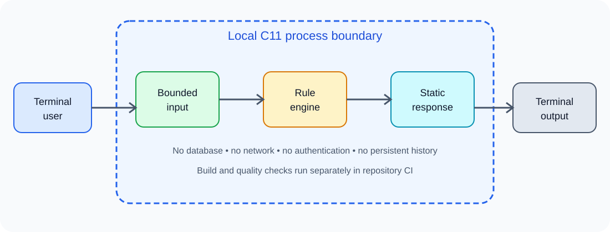
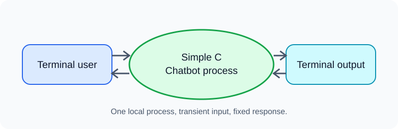
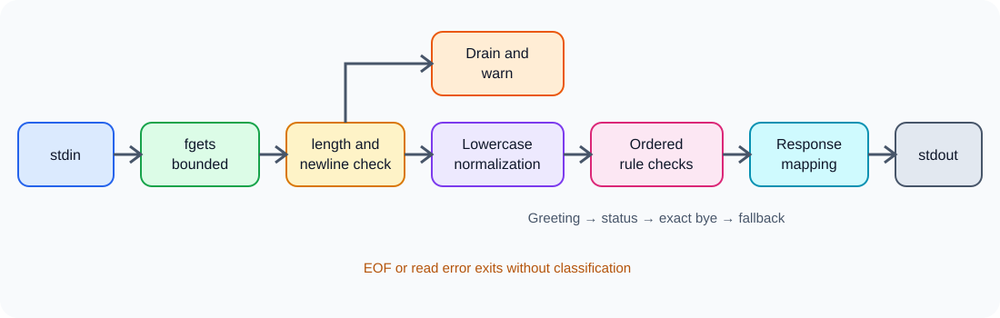
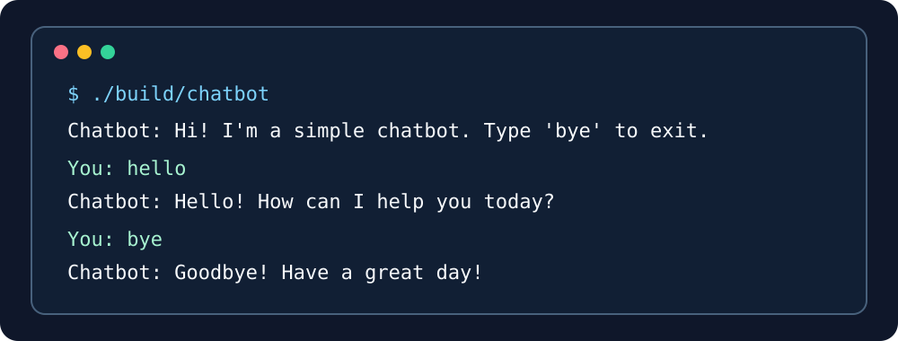
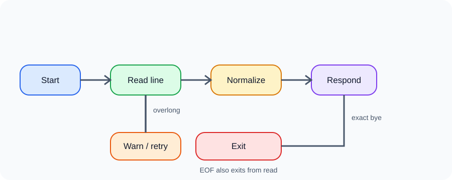
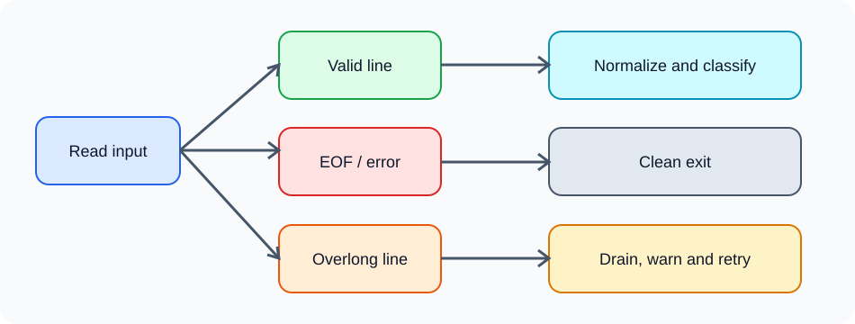
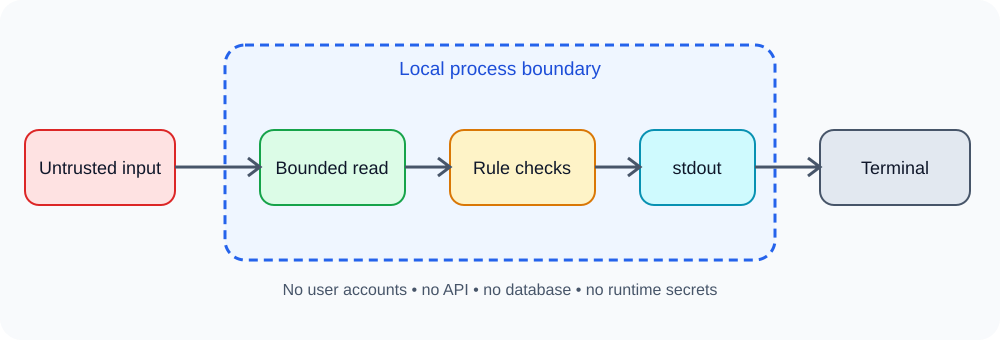

  

  

<h1 align="center">💬 Simple C Chatbot</h1>

  <strong>A deterministic command-line chatbot written in standard C.</strong>
   
  A compact learning project for input handling, string processing, control flow, and defensive programming.

  
  
  
  
   
  
  
  
  
  
  

> ⚠️ **Important scope note:** This is a rule-based educational C program, not an AI chatbot or an LLM application. It has no model, internet connection, API, database, account system, or conversation memory.

---

## 🧭 Contents

- [🎯 Project overview](#-project-overview)
- [✨ Features](#-features)
- [⚙️ Behavior specification](#️-behavior-specification)
- [🏗️ Architecture and diagrams](#️-architecture-and-diagrams)
- [🚀 Installation and quick start](#-installation-and-quick-start)
- [💬 Example sessions](#-example-sessions)
- [🧪 Testing and verification](#-testing-and-verification)
- [🧰 Build commands](#-build-commands)
- [🗂️ Repository structure](#️-repository-structure)
- [🔐 Security, privacy, and accessibility](#-security-privacy-and-accessibility)
- [🧱 Technology and compatibility](#-technology-and-compatibility)
- [📚 Documentation and templates](#-documentation-and-templates)
- [🤝 Contributing](#-contributing)
- [🗺️ Roadmap](#️-roadmap)
- [❓ Frequently asked questions](#-frequently-asked-questions)
- [📄 License and attribution](#-license-and-attribution)

---

## 🎯 Project overview

**Simple C Chatbot** is a terminal application that reads one line of text, normalizes the accepted input, checks a small set of phrase rules, and prints a fixed response. The implementation is intentionally small enough to inspect, while still addressing common input-handling mistakes.

### 🎓 Learning objectives

This repository demonstrates:

- C11 syntax, functions, enums, arrays, and character strings.
- Standard input/output and process termination.
- Case normalization and ordered conditional rules.
- Safe use of the C character-conversion functions.
- Bounded input, overlong-line handling, and EOF behavior.
- Unit testing and process-level integration testing.
- Make-based builds and GitHub Actions verification.

### ✅ Runtime workflow

1. Print the welcome message and prompt.
2. Read one logical line into a fixed-size character buffer.
3. Distinguish an accepted line from an overlong line, EOF, or an input error.
4. Drain and reject an overlong line instead of processing its remaining bytes as another message.
5. Normalize accepted input to lowercase.
6. Evaluate phrase rules in a fixed order.
7. Print the matching response and continue, or exit on the exact command.

### 🚫 Explicit product boundaries

The application does not understand natural language, generate novel answers, call an AI model, learn from user messages, save chat history, or communicate with a remote service. It is not a web application, REST API, GUI, messaging platform, or hosted conversational product.

---

## ✨ Features

| Feature | Project behavior |
|---|---|
| 💬 Terminal conversation | Reads a line and responds through standard input/output |
| 🔤 Case normalization | Converts accepted input to lowercase before matching |
| 👋 Greeting rule | Matches the phrase `hello` anywhere in the accepted input |
| 🙂 Status rule | Matches the phrase `how are you` when the earlier greeting rule does not match |
| 🚪 Exact exit command | Exits only when the complete normalized input equals `bye` |
| 🧱 Bounded input | Accepts a maximum of 255 input bytes in a 256-byte buffer |
| 🧯 Overlong-line handling | Drains and rejects the remainder of an overlong logical line |
| 📭 EOF handling | Exits cleanly when standard input closes or reaches EOF |
| 🧪 Automated verification | Includes C unit checks and actual-process input/output tests |
| 🛠️ Lightweight toolchain | Uses a C compiler, Make, shell/Python validation scripts, and GitHub Actions |

### Why the input handling is important

A simple `fgets()` example can accidentally treat the remainder of a long line as a new message. This program checks whether the input buffer filled before the logical line ended. It probes one additional character to distinguish an exact-fit line from an overlong one. If the line is too long, it drains the remainder before displaying the next prompt.

That behavior is covered by boundary tests. It is not merely a documentation claim.

---

## ⚙️ Behavior specification

### 1. Rule precedence

The chatbot evaluates rules in the following order. The first matching rule determines the response.

| Priority | Match condition | Response | Session behavior |
|---:|---|---|---|
| 1 | Input contains `hello` | Hello! How can I help you today? | Continues |
| 2 | Input contains `how are you` | I'm just a program, but thanks for asking! | Continues |
| 3 | Entire normalized input equals `bye` | Goodbye! Have a great day! | Exits |
| 4 | No earlier rule matches | I'm sorry, I don't understand that. | Continues |

The ordering is observable and intentional. For example, `hello and bye` matches the greeting rule first, so the session continues. The word `goodbye` does not exit because it is not exactly equal to `bye`.

### 2. Input boundary contract

The application declares a 256-byte buffer. One byte is reserved for the terminating NUL character, so the maximum accepted message is 255 bytes.

| Input case | Expected result |
|---|---|
| 254 bytes followed by newline | ✅ Accepted |
| 255 bytes followed by newline | ✅ Accepted |
| 255 bytes followed directly by EOF | ✅ Accepted as the final unterminated line |
| 256 bytes followed by newline | ❌ Rejected; remainder drained |
| 256 bytes followed directly by EOF | ❌ Rejected; the next read handles EOF |
| Empty input stream | 📭 Prints the input-closed message and exits |
| Empty line followed by newline | 🔁 Treated as a message and receives the fallback response |

**The limit is measured in bytes, not characters.** UTF-8 characters may occupy multiple bytes. Lowercasing is byte-oriented and is not Unicode case folding.

### 3. Internal function responsibilities

| Function | Responsibility |
|---|---|
| `main()` | Owns the prompt/read/respond loop and process termination |
| `read_input_line()` | Reads a bounded logical line and reports accepted, ended, or overlong input |
| `normalize_input()` | Converts accepted bytes to lowercase using an unsigned-char conversion |
| `classify_input()` | Applies greeting, status, exit, and fallback precedence |
| `is_exit_command()` | Checks whether the whole string equals `bye` |
| `response_text()` | Maps the response enum to a fixed response string |

These functions are file-local implementation details in `chatbot/chatbot.c`. They are not a separately published C library API.

---

## 🏗️ Architecture and diagrams

The chatbot runs as one local process. There is no client/server boundary, remote API, persistent database, or model provider.

### 1. High-level system design

### 2. Application component flow

### 3. Data-flow diagrams

### 4. Runtime activity flow

~~~mermaid
flowchart TD
    A([Start]) --> B[Print welcome and prompt]
    B --> C[Read one logical line]
    C --> D{Read result}
    D -->|EOF or error| X[Print input closed]
    D -->|Overlong| E[Drain remaining bytes]
    E --> F[Print length warning]
    F --> B
    D -->|Accepted| G[Normalize input]
    G --> H{Contains hello?}
    H -->|Yes| I[Greeting response]
    H -->|No| J{Contains how are you?}
    J -->|Yes| K[Status response]
    J -->|No| L{Input equals bye?}
    L -->|Yes| M[Goodbye response]
    L -->|No| N[Fallback response]
    I --> B
    K --> B
    N --> B
    M --> X
    X --> Z([Exit])
~~~

### 5. Runtime sequence

~~~mermaid
sequenceDiagram
    actor User
    participant Main as main()
    participant Reader as read_input_line()
    participant Rules as normalize and classify
    participant Output as stdout

    Main->>Output: Print welcome
    loop Until bye, EOF, or read error
        Main->>Output: Print prompt and flush
        User->>Reader: Enter one line
        alt Accepted input
            Reader-->>Main: NUL-terminated line
            Main->>Rules: Normalize and classify
            Rules-->>Main: ResponseKind
            Main->>Output: Print fixed response
        else Overlong line
            Reader-->>Main: Drain and reject
            Main->>Output: Print 255-byte warning
        else EOF or input error
            Reader-->>Main: End status
            Main->>Output: Print input-closed message
        end
    end
~~~

### 6. Application state and error handling

### 7. Security and trust boundary

### Diagram scope and limitations

The repository also contains contribution, CI, testing, deployment, rule-priority, and input-boundary visuals. Browse the [visual asset catalogue](docs/assets/README.md) and [diagram catalogue](docs/diagrams.md).

An ER diagram is not applicable because the application has no database or persistent domain records. A UML class diagram is not applicable because the source is procedural C and has no class model. These are deliberate architecture boundaries, not missing implementation work.

---

## 🚀 Installation and quick start

### Prerequisites

| Tool | Required? | Purpose |
|---|---|---|
| C11-compatible compiler | ✅ Yes | Build the chatbot |
| GNU Make | Recommended | Use the repository build and test targets |
| Python 3 | Recommended | Run documentation and repository validation scripts |
| POSIX shell utilities | Required for Linux process tests | Run the shell integration suite |
| PowerShell | Required for Windows process tests | Run the Windows integration suite |

The chatbot executable only needs a compatible C runtime. Python and Make are development tools, not runtime dependencies.

### 1. Clone the repository

~~~sh
git clone https://github.com/Brajesh31/chatbot-C-.git
cd chatbot-C-
~~~

### 2. Build on Linux

~~~sh
make
~~~

The Makefile creates the application at `build/chatbot`.

### 3. Run the chatbot

~~~sh
./build/chatbot
~~~

### Windows with MinGW-w64

Open PowerShell in the repository directory:

~~~powershell
gcc -std=c11 -Wall -Wextra -Wpedantic -Werror chatbot/chatbot.c -o chatbot.exe
.\chatbot.exe
~~~

### Direct compilation without Make

~~~sh
cc -std=c11 -Wall -Wextra -Wpedantic -Werror chatbot/chatbot.c -o chatbot
./chatbot
~~~

The repository retains `chatbot/chatbot.exe` as a historical binary. It is not the authoritative build output. Compile the current source for the platform you intend to use.

---

## 💬 Example sessions

### Normal conversation

~~~text
Chatbot: Hi! I'm a simple chatbot. Type 'bye' to exit.
You: hello
Chatbot: Hello! How can I help you today?
You: how are you?
Chatbot: I'm just a program, but thanks for asking!
You: tell me a story
Chatbot: I'm sorry, I don't understand that.
You: goodbye
Chatbot: I'm sorry, I don't understand that.
You: bye
Chatbot: Goodbye! Have a great day!
~~~

### Overlong input

~~~text
Chatbot: Hi! I'm a simple chatbot. Type 'bye' to exit.
You: [256-byte message]
Chatbot: Please keep your message to 255 bytes or fewer.
You: bye
Chatbot: Goodbye! Have a great day!
~~~

The overlong message is rejected as one logical line. Its remaining characters are discarded, and the next prompt starts with fresh input.

---

## 🧪 Testing and verification

The test suite checks both helper behavior and the behavior of the compiled executable.

### Test files

| Test file | Verification scope | Platform |
|---|---|---|
| `tests/test_chatbot.c` | Greeting, normalization, status phrase, exact exit matching, fallback, and empty input | Linux and Windows CI |
| `tests/test_interactive.sh` | Real stdin/stdout behavior, EOF, line boundaries, overlong-line draining, and subsequent input | Linux / POSIX |
| `tests/test_interactive.ps1` | Real process behavior, redirected streams, EOF, and line boundaries | Windows |

### Scenario matrix

| Scenario | C unit tests | POSIX process tests | Windows PowerShell tests |
|---|---:|---:|---:|
| Greeting, status, and fallback | ✅ | ✅ | ✅ |
| Case normalization | ✅ | ✅ | ✅ |
| Rule precedence | ✅ | ✅ | ✅ |
| Exact `bye` versus `goodbye` | ✅ | ✅ | ✅ |
| Empty input and EOF | Limited | ✅ | ✅ |
| 254/255/256-byte boundaries | Helper behavior | ✅ | ✅ |
| Overlong line followed by a valid command | N/A | ✅ | ✅ |

This matrix describes the checked-in test cases. It is not a claim of exhaustive testing across every byte sequence, locale, compiler, terminal, or operating system.

### Run tests locally

Linux or a compatible POSIX shell:

~~~sh
make test
~~~

Run the complete local verification suite:

~~~sh
make check
~~~

Windows with MinGW-w64 and PowerShell:

~~~powershell
gcc -std=c11 -Wall -Wextra -Wpedantic -Werror chatbot/chatbot.c -o chatbot-ci.exe
gcc -std=c11 -Wall -Wextra -Wpedantic -Werror tests/test_chatbot.c -o chatbot-tests.exe
.\chatbot-tests.exe
pwsh -NoProfile -File tests/test_interactive.ps1 -AppPath ".\chatbot-ci.exe"
~~~

### Continuous integration

| Workflow | Responsibility |
|---|---|
| `ci.yml` | Linux build and full local quality gate; Windows MinGW build, C unit tests, and PowerShell process tests |
| `lint.yml` | Markdown fence, documentation, asset, and tracked-tree checks |
| `docs-validation.yml` | Local documentation link and SVG validation |
| `security-scan.yml` | Gitleaks history scan, repository secret-pattern check, tests, and GCC analyzer |
| `codeql.yml` | CodeQL C/C++ analysis |
| `dependency-review.yml` | Pull-request dependency review |
| `release.yml` | Manual Linux source artifact workflow for an existing tag |

The workflow files are maintained under [`.github/workflows/`](.github/workflows/). A configured workflow is not proof that every run passed. Check the live [GitHub Actions page](https://github.com/Brajesh31/chatbot-C-/actions) for current results.

---

## 🧰 Build commands

| Command | Purpose |
|---|---|
| `make` | Build the application |
| `make run` | Build and launch the application |
| `make test` | Run C unit tests and POSIX process tests |
| `make docs-check` | Validate local documentation links and SVG files |
| `make markdown-check` | Check tracked Markdown code fences |
| `make structure-check` | Compare the documented tree with tracked Git files |
| `make security-check` | Run local secret-pattern hygiene checks |
| `make check` | Run tests and all local quality checks |
| `make clean` | Remove the generated `build/` directory |

### Build variable overrides

The Makefile supports compiler, compiler-flag, and Python-command overrides.

~~~sh
make CC=clang
make CFLAGS="-std=c11 -Wall -Wextra -Wpedantic -Werror -g"
make PYTHON=python3 check
~~~

The Clang command is a local override option, not a claim that Clang is already part of the project's CI matrix.

---

## 🗂️ Repository structure

The repository contains **292 tracked files** covering the C source, tests, 32 reusable templates, 22 SVG assets, technical documentation, and GitHub automation.

| Directory / file | Purpose |
|---|---|
| `chatbot/chatbot.c` | Application source code |
| `chatbot/chatbot.exe` | Retained historical Windows executable |
| `tests/` | C unit tests and Linux/Windows process-level tests |
| `docs/` | Product, architecture, development, QA, security, privacy, accessibility, release, and maintenance guides |
| `docs/assets/` | Project identity, architecture, workflow, state, sequence, DFD, and security visuals |
| `docs/templates/` | Reusable product, engineering, QA, security, incident, and release templates |
| `docs/decisions/` | Architecture Decision Records |
| `scripts/` | Documentation, structure, security, release, and setup helpers |
| `.github/` | Issue forms, PR guidance, discussions, Dependabot, and Actions workflows |
| `Makefile` | Build, run, test, and local quality-gate targets |
| `README.md` | Project entry point and usage guide |
| `LICENSE` | MIT license |

For the complete file-by-file listing, see [`docs/project-structure.md`](docs/project-structure.md). That file is the authoritative expanded repository inventory.

---

## 🔐 Security, privacy, and accessibility

### Security controls

- 🧱 User input is read into a fixed-size buffer.
- 🧮 The reader distinguishes exact-fit input from overlong input.
- 🧹 The remainder of an overlong line is drained before another prompt.
- 🔡 Character conversion passes an unsigned-char value to `tolower()`.
- 🚪 Exit matching compares the complete normalized input with `bye`.
- 🔌 The application does not open network connections or expose a listening service.
- 🧪 Security-relevant source changes should include regression tests.

### Privacy behavior

The application does not create user accounts, send messages to an external service, or persist conversation history. Messages are processed in memory for the active process. The security and privacy documentation describes the actual local-program boundary.

### Accessibility considerations

The interface is plain terminal text. It does not depend on color, animation, mouse interaction, or graphical controls. Terminal font, contrast, screen-reader behavior, and keyboard editing are provided by the user's terminal environment, not controlled by the chatbot itself.

### Security limitations

This project has not undergone an independent security audit or formal accessibility certification. Static analysis and automated tests reduce some risks but do not prove the absence of defects. The historical executable is not provenance-attested by source CI.

- [Security policy](SECURITY.md)
- [GitHub security reporting pointer](.github/SECURITY.md)
- [Threat assessment](docs/threat-assessment.md)
- [Security architecture](docs/security-architecture.md)
- [Privacy and data handling](docs/data-privacy.md)
- [Terminal accessibility](docs/terminal-accessibility.md)

---

## 🧱 Technology and compatibility

### Technology stack

| Layer | Technology | Role |
|---|---|---|
| Language | C11 | Application implementation |
| Runtime | C standard library | Input/output, strings, and character conversion |
| Build | GNU Make and a C compiler | Compile application and test executable |
| Unit testing | C assertions | Verify normalization and classification helpers |
| Linux integration | POSIX shell and standard utilities | Exercise the compiled program through stdin/stdout |
| Windows integration | PowerShell process APIs | Exercise the compiled Windows program |
| Static analysis | GCC analyzer and CodeQL | Source-level checks |
| Documentation | Markdown, Mermaid, and SVG | Technical explanation and architecture visuals |
| Validation scripts | Python standard library | Links, SVG, Markdown fences, and repository structure |

There is no JavaScript application, web frontend, backend service, third-party C runtime dependency, database, model provider, or cloud deployment.

### Compatibility status

| Platform | Evidence | Status |
|---|---|---|
| Linux | GCC-compatible C11 build, unit tests, POSIX process tests, and `make check` in CI | ✅ CI configured |
| Windows | MinGW GCC C11 build, C unit tests, and PowerShell process tests in CI | ✅ CI configured |
| macOS | No current CI job | ⚪ Not verified by this repository's CI |
| Other Unix-like systems | No current CI job | ⚪ Not verified |

See [compiler support](docs/compiler-support.md), [build matrix](docs/build-matrix.md), and [compatibility notes](docs/compatibility.md) before making platform-support claims.

---

## 📚 Documentation and templates

The documentation set is organized around the actual C command-line application. Some documents describe non-applicable architecture areas so future maintainers can see why those features are absent and what would need to change before adopting them.

### Start here

- 📘 [Documentation index](docs/README.md)
- 🧭 [Product overview](docs/product-overview.md)
- 🏗️ [Architecture](docs/architecture.md)
- 🔍 [System design](docs/system-design.md)
- 🧑‍💻 [Getting started](docs/getting-started.md)
- 🔧 [Development workflow](docs/development-workflow.md)
- 🧪 [Testing strategy](docs/test-strategy.md)
- 🗂️ [Complete repository structure](docs/project-structure.md)

### Architecture and diagrams

- [Architecture Decision Records](docs/decisions/README.md)
- [Diagram catalogue](docs/diagrams.md)
- [Data flow](docs/data-flow.md)
- [Sequence diagrams](docs/sequence-diagrams.md)
- [State diagrams](docs/state-diagrams.md)
- [Visual asset catalogue](docs/assets/README.md)

### Quality, security, and operations

- [Quality gates](docs/quality-gates.md)
- [Testing matrix](docs/testing-matrix.md)
- [Security guide](docs/security.md)
- [Vulnerability management](docs/vulnerability-management.md)
- [Incident response](docs/incident-response.md)
- [Release process](docs/release-process.md)
- [Troubleshooting](docs/troubleshooting.md)

### Reusable templates

The repository provides **32 templates**. Selected templates include:

| Template | Purpose |
|---|---|
| [Architecture Decision Record](docs/templates/adr-template.md) | Record an engineering decision and its trade-offs |
| [Feature specification](docs/templates/feature-specification-template.md) | Define proposed behavior and acceptance criteria |
| [Bug report](docs/templates/bug-report-template.md) | Report a defect with reproduction details |
| [Reproduction record](docs/templates/reproduction-record-template.md) | Capture environment, minimal steps, and expected/actual behavior |
| [Test plan](docs/templates/test-plan-template.md) | Scope test activity and exit criteria |
| [Test report](docs/templates/test-report-template.md) | Record executed checks and evidence |
| [Threat assessment](docs/templates/threat-assessment-template.md) | Capture threats and trust boundaries |
| [Security exception](docs/templates/security-exception-template.md) | Record a time-bound control exception |
| [Release checklist](docs/templates/release-checklist-template.md) | Review release readiness |
| [Release notes](docs/templates/release-notes-template.md) | Communicate verified release changes |

Browse the [complete template catalogue](docs/templates/README.md).

### Governance and project history

- [Contribution guidelines](CONTRIBUTING.md)
- [Code of conduct](CODE_OF_CONDUCT.md)
- [Maintainer guidance](MAINTAINERS.md)
- [Support policy](SUPPORT.md)
- [Changelog](CHANGELOG.md)
- [Roadmap](ROADMAP.md)
- [Citation metadata](CITATION.cff)
- [Acknowledgements](ACKNOWLEDGEMENTS.md)

---

## 🤝 Contributing

Contributions should improve the actual C application or its supporting engineering material. Avoid adding unrelated infrastructure merely to increase the repository's file count.

### Contribution workflow

~~~mermaid
flowchart LR
    A[Read scope and guidelines] --> B[Open or select an issue]
    B --> C[Make a focused change]
    C --> D[Add or update tests]
    D --> E[Run make check]
    E --> F{Checks pass?}
    F -->|No| C
    F -->|Yes| G[Update relevant docs]
    G --> H[Open pull request]
    H --> I[Review and merge]
~~~

### Before opening a pull request

1. Read [CONTRIBUTING.md](CONTRIBUTING.md) and the [Code of Conduct](CODE_OF_CONDUCT.md).
2. Keep the change focused and consistent with the single-process C design unless an approved proposal changes that scope.
3. Add regression tests for changed behavior, especially input boundaries and exit behavior.
4. Run the relevant tests and `make check` where supported.
5. Update architecture, security, and user documentation when behavior or trust boundaries change.
6. Do not commit credentials, generated build output, or fabricated test evidence.

Use the repository issue forms for bug reports, feature requests, documentation corrections, accessibility concerns, and performance reports. Report vulnerabilities privately through the [security policy](SECURITY.md), not through a public issue.

---

## 🗺️ Roadmap

The roadmap lists proposals, not commitments that every item will be implemented.

Potential engineering improvements include:

- 🧪 Add sanitizer-enabled CI checks.
- 🧰 Expand compiler and operating-system coverage with Clang and macOS.
- 🔬 Add bounded fuzz/property testing for input handling and classification.
- 📊 Add measured branch/line coverage reporting with retained evidence.
- 🆘 Consider a help/version command if there is a concrete user need.

An AI model, network API, database, authentication system, browser UI, mobile application, analytics platform, and cloud deployment are outside the current project scope.

See [ROADMAP.md](ROADMAP.md) for maintained priorities and acceptance evidence.

---

## ❓ Frequently asked questions

**Is this an AI chatbot?**  
No. The application uses fixed phrase checks and fixed response strings. It does not call an AI or language model.

**Does it need an internet connection?**  
No. The executable runs locally and has no network integration.

**Does it remember previous messages?**  
No. It does not persist chat history.

**Why does `goodbye` not exit?**  
Only the entire normalized input `bye` is treated as the exit command.

**What is the maximum input length?**  
255 bytes per logical line. The buffer is 256 bytes including the terminating NUL.

**Why is a long line rejected instead of truncated?**  
To prevent the remaining part of one message from being interpreted as a separate message.

**Does it have a GUI, API, database, or login system?**  
No. It is a single-process terminal program.

**Can I compile it with Clang?**  
The Makefile accepts a compiler override such as `make CC=clang`, but Clang and macOS are not currently part of the CI compatibility matrix.

For further information, see the [FAQ](docs/faq.md) and [known limitations](docs/scope-and-limitations.md).

---

## 📄 License and attribution

This project is released under the **MIT License**. See [`LICENSE`](LICENSE) for the complete terms.

Copyright (c) 2026 **Brajesh Kumar**.

For contributor and attribution information, see [`AUTHORS.md`](AUTHORS.md) and [`ACKNOWLEDGEMENTS.md`](ACKNOWLEDGEMENTS.md).
