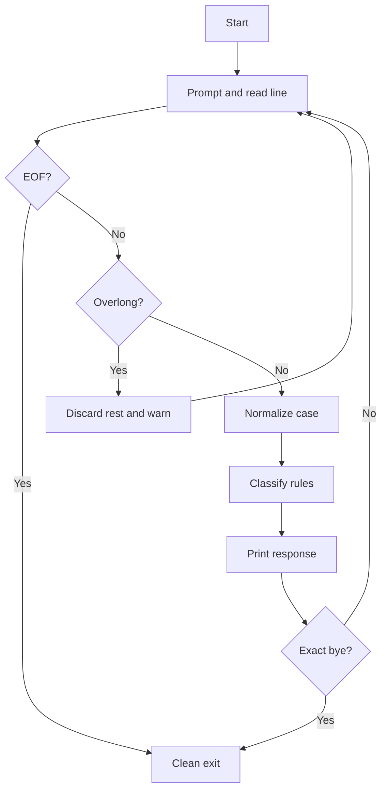

# 💬 Simple C Chatbot

<p align="center">
   
</p>

> A small deterministic, rule-based command-line chatbot written in standard C. **This is not an AI or LLM application.** It runs locally, uses fixed phrase rules, makes no network requests, and does not save conversation history.

## 📑 Contents
- [Overview](#-overview)
- [Features](#-features)
- [Flow](#-flow)
- [Rules](#-rules)
- [Build](#-build)
- [Run and test](#-run-and-test)
- [Structure](#-structure)
- [Limitations](#-limitations)
- [Documentation](#-documentation)
- [Contributing](#-contributing)
- [License](#-license)

## 🎯 Overview
The program reads a line from standard input, normalizes its case, classifies it using a small set of ordered conditions, and prints a fixed response. It demonstrates arrays, functions, enums, strings, bounded input, standard I/O, and control flow in C.

## ✨ Features
- 🗣️ Interactive terminal conversation.
- 🔤 Case-insensitive ASCII phrase matching.
- 👋 Greeting and status responses.
- 🚪 Exact `bye` command exits.
- 🧱 Bounded 255-byte input with overlong-line rejection.
- 🧯 Graceful EOF handling.
- 🧪 C unit tests and shell integration tests.
- 🧰 Makefile and GCC/Clang-compatible build.

## 🔄 Flow




## 💬 Rules
| Input | Result |
|---|---|
| `hello` or `HELLO there` | Greeting |
| `how are you?` | Status |
| `bye` | Goodbye and exit |
| `goodbye` | Fallback, no exit |
| `hello and bye` | Greeting, continues |
| Anything else | Fallback |

Greeting/status matching uses substrings. Exit matching requires the complete normalized input to equal `bye`.

## 🧰 Requirements
A C11 compiler such as GCC, Clang, or MinGW-w64. GNU Make is recommended but optional. No third-party runtime libraries or internet connection are required.

## 🚀 Build
Linux/macOS:
```sh
git clone https://github.com/Brajesh31/chatbot-C-.git
cd chatbot-C-
make
./build/chatbot
```
Windows with MinGW-w64:
```powershell
gcc -std=c11 -Wall -Wextra -Wpedantic chatbot/chatbot.c -o chatbot-build.exe
.\chatbot-build.exe
```
Direct build:
```sh
cc -std=c11 -Wall -Wextra -Wpedantic chatbot/chatbot.c -o chatbot-build
./chatbot-build
```
The tracked `chatbot/chatbot.exe` is a historical Windows binary. Build from source for the target OS; generated files use separate names.

## 🧪 Run and test
```sh
make test
```
Tests cover rule selection, normalization, exact exit matching, unknown/empty input, EOF, and long input. CI builds and tests on Linux and Windows. See [testing guide](docs/testing.md).

## 🗂️ Structure
```text
chatbot-C-/
├── .github/                 Issue forms, PR template, CI and CodeQL
├── chatbot/chatbot.c        C implementation
├── chatbot/chatbot.exe      Existing Windows binary
├── docs/                    Technical guides, diagrams, decisions, templates
├── tests/                   Unit and interactive tests
├── Makefile                 Build/test/clean commands
├── README.md
├── GOVERNANCE.md
├── DISCLAIMER.md
└── project policies
```
See [project structure](docs/project-structure.md).

## 🔐 Security and privacy
The program runs locally, uses bounded input, does not read secrets, and does not persist messages. The checked-in executable is a binary artifact; compile reviewed source when provenance matters. This is not a formal security audit. See [SECURITY.md](SECURITY.md).

## ⚠️ Limitations
There is no natural-language understanding, model, memory, personalization, language detection, GUI, voice support, database, or remote service. Responses are fixed and may be irrelevant.

## 📚 Documentation
- [Documentation index](docs/README.md)
- [Installation](docs/installation.md)
- [Architecture](docs/architecture.md)
- [API](docs/api.md)
- [Development](docs/development.md)
- [Testing](docs/testing.md)
- [Troubleshooting](docs/troubleshooting.md)
- [Deployment](docs/deployment.md)
- [Security notes](docs/security.md)
- [Accessibility](docs/accessibility.md)
- [Templates](docs/templates/README.md)

## 🤝 Contributing
See [CONTRIBUTING.md](CONTRIBUTING.md) and [CODE_OF_CONDUCT.md](CODE_OF_CONDUCT.md). Keep changes small, portable, tested, and accurately documented.

## 🗺️ Roadmap
See [ROADMAP.md](ROADMAP.md). Proposed features are not current functionality.

## 📄 License
MIT License. Copyright Brajesh Kumar (`@brajesh31`). See [LICENSE](LICENSE).

Last updated: 2026-11-17 11:12 UTC
