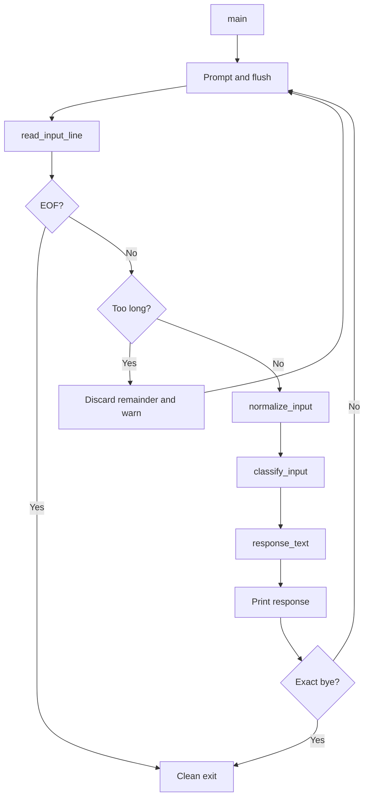

# 🏗️ Architecture

The program is a single-process C11 console application. It reads a bounded line, normalizes case, classifies input using ordered rules, prints a fixed response, then repeats until exact `bye` or EOF.

## Function responsibilities
| Function | Purpose |
|---|---|
| `read_input_line` | Bounded read, EOF detection, overlong-line draining |
| `normalize_input` | Lowercase normalization with unsigned-char conversion |
| `is_exit_command` | Exact `bye` matching |
| `classify_input` | Ordered rule selection |
| `response_text` | Enum-to-string mapping |
| `main` | Terminal interaction and termination |

Rule priority: contains `hello`, else contains `how are you`, else exact `bye`, else fallback. Thus `hello and bye` greets and continues; only exact `bye` exits.

The buffer is 256 bytes, allowing 255 input bytes plus NUL. Longer lines are drained and rejected as one message. EOF exits safely. The program uses the C standard library only and has no API, database, persistence, authentication, or remote model.
