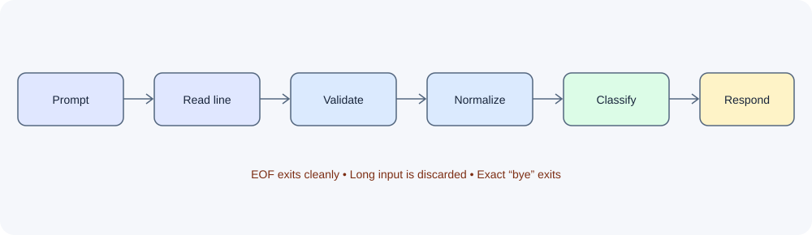

# 🏗️ Architecture and Runtime Design

## 1. System boundary

Simple C Chatbot is a single-process C11 command-line application. Its only user interaction is standard input and standard output. The process reads one logical line, checks its length, normalizes accepted bytes, selects one fixed response and repeats until exact `bye`, EOF or an input error.

It has no network client or listener, browser interface, external model, database, file-based conversation history, account system, background worker or telemetry sender.

## 2. Context and trust boundaries

~~~mermaid
flowchart LR
 U[Human user] -->|Untrusted bytes| I[stdin]
 I --> R[Bounded input reader]
 R -->|Accepted line| N[Normalizer]
 N --> C[Ordered rule classifier]
 C --> S[Static response mapping]
 S --> O[stdout]
 O --> U
 R -->|Too long| W[Drain and warn]
 R -->|EOF or error| X[Exit]
~~~

The user-controlled input is treated as data, not as a command or a format string. The application does not execute input, interpolate it into a shell command, or use it to select a file path. The response is selected from compile-time string constants.

## 3. Internal component model

| Component | Source symbol | Input | Output | Key invariant |
|---|---|---|---|---|
| Application loop | `main` | Process stdin | Prompt, response, exit code | Only accepted lines reach normalization/classification |
| Line reader | `read_input_line` | Buffer, capacity, stdin | Accepted / end / too long status | One logical line is never split into multiple turns |
| Normalizer | `normalize_input` | Mutable NUL-terminated bytes | Lowercase bytes | `tolower` receives an unsigned-char conversion |
| Exit predicate | `is_exit_command` | Normalized string | Boolean-like integer | Only complete string `bye` is an exit |
| Classifier | `classify_input` | Normalized string | `ResponseKind` | Rule order is deterministic |
| Response mapper | `response_text` | Response enum | Static string | User text is never used as a format string |

The functions are static and private to the translation unit. There is no public library ABI or separately deployed service interface.

## 4. Runtime processing

~~~mermaid
flowchart TD
 A([Start]) --> B[Print welcome]
 B --> C[Print prompt and flush stdout]
 C --> D[Read line into 256-byte buffer]
 D --> E{Reader status}
 E -->|EOF or stream error| Z[Print input-closed message]
 E -->|Overlong| F[Drain line remainder]
 F --> G[Print 255-byte warning]
 G --> C
 E -->|Accepted| H[Normalize bytes]
 H --> I{Contains hello?}
 I -->|Yes| J[Greeting response]
 I -->|No| K{Contains how are you?}
 K -->|Yes| L[Status response]
 K -->|No| M{Exact bye?}
 M -->|Yes| N[Goodbye response]
 M -->|No| O[Fallback response]
 J --> P[Print selected constant]
 L --> P
 N --> P
 O --> P
 P --> Q{Goodbye?}
 Q -->|Yes| Z
 Q -->|No| C
 Z --> R([Exit])
~~~

### Line reader contract

The input buffer has 256 bytes. Up to 255 input bytes fit alongside the NUL terminator. When `fgets` fills the data area without including a newline, the reader probes one more byte:
- Newline means the 255-byte line was exactly complete and is accepted.
- Clean EOF means the final unterminated line has exactly 255 bytes and is accepted.
- Any additional data means the logical line is overlong. The rest is consumed until newline or EOF and the whole line is rejected.
- A stream error returns the input-ended status.

This avoids both buffer overflow and accidental interpretation of a long message tail as a second message.

## 5. Rule precedence and examples

| Order | Predicate | Response | Session effect |
|---:|---|---|---|
| 1 | Contains `hello` | Greeting | Continue |
| 2 | Contains `how are you` | Status | Continue |
| 3 | Whole normalized value equals `bye` | Goodbye | Exit |
| 4 | None match | Fallback | Continue |

| Example | Selected behavior | Why |
|---|---|---|
| `HELLO there` | Greeting | Case is normalized before matching |
| `hello and bye` | Greeting | Greeting has higher priority |
| `how are you?` | Status | Status rule matches a substring |
| `goodbye` | Fallback | Exit requires exact equality with `bye` |
| Empty line | Fallback | No earlier predicate matches |

## 6. Memory and data lifecycle

The program uses a stack-allocated input buffer in `main`. Each accepted line is overwritten by the next read. No conversation database, filesystem log, cache, or remote storage exists. The operating system and terminal may independently retain input/output according to their own behavior, which is outside the chatbot's application-level retention model.

## 7. Failure behavior

| Condition | Handling | Remaining limitation |
|---|---|---|
| EOF | Stop the loop without classifying stale buffer content | Output errors are not comprehensively checked |
| Input stream error | Use the input-ended path | No detailed diagnostic differentiates EOF from I/O failure |
| Overlong line | Drain the remaining logical line, warn, continue | Limit is bytes, not Unicode characters |
| Invalid internal capacity | Reader reports a non-accepted status | Internal caller always supplies the fixed valid buffer |
| Unknown enum value | Response mapper uses fallback text | The enum is internal, not externally supplied |

## 8. Architecture decisions

- Standard C and a console interface keep the runtime dependency-free.
- A bounded reader provides an explicit input safety limit.
- Ordered substring rules keep behavior transparent for a learning project.
- Exact equality for the exit command avoids accidental termination by words such as `goodbye`.
- The historical executable is not treated as a reproducible release artifact; build from source for the current platform.

See [architecture decisions](decisions/README.md), [sequence diagrams](sequence-diagrams.md), [state diagrams](state-diagrams.md), [data flow](data-flow.md), and [security architecture](security-architecture.md).
