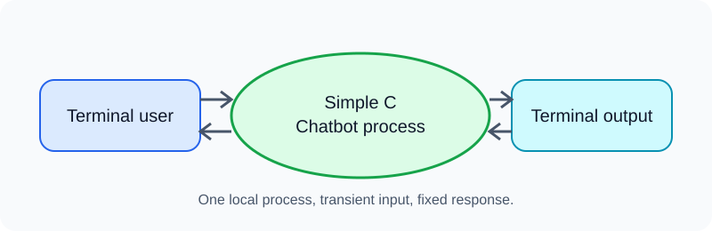
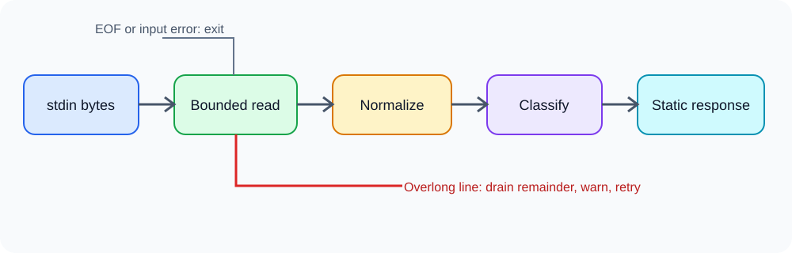
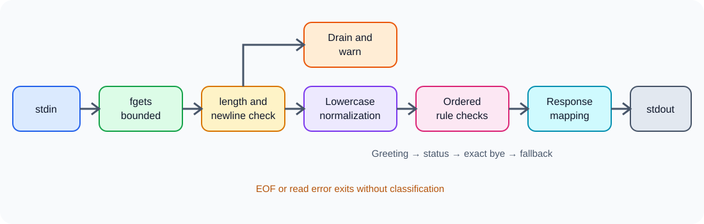

# 🔀 Data Flow and Information Lifecycle

## 1. Scope

The application accepts text through standard input, processes one logical line in memory, maps the result to a fixed response, and writes that response to standard output. This page describes runtime data movement. It does not describe a database, remote API or persistent conversation store because none exists in the current source.

## 2. Context-level DFD, level 0

~~~mermaid
flowchart LR
 User[Terminal user] -->|Input bytes| App((Simple C Chatbot process))
 App -->|Prompt and fixed response| User
~~~

## 3. Process-level DFD, level 1

~~~mermaid
flowchart TD
 U[stdin bytes] --> R[Read one bounded logical line]
 R -->|Accepted| N[Normalize accepted bytes]
 R -->|Too long| D[Drain remainder]
 D --> W[Print warning]
 W --> U
 R -->|EOF or read error| X[End process]
 N --> C[Apply ordered phrase rules]
 C --> M[Select fixed response constant]
 M --> O[Write stdout]
 O --> Q{Exact exit response?}
 Q -->|No| U
 Q -->|Yes| X
~~~

## 4. Detailed DFD, level 2

~~~mermaid
flowchart TD
 A[stdin] --> B[fgets into 256-byte array]
 B --> C{Read succeeded?}
 C -->|No| X[EOF or input error]
 C -->|Yes| D{Newline captured?}
 D -->|Yes| G[Remove newline]
 D -->|No| E{Buffer at capacity?}
 E -->|No| F[Final line at EOF]
 E -->|Yes| H[Probe next byte]
 H -->|Newline or clean EOF| G
 H -->|Additional byte| I[Drain to newline or EOF]
 I --> J[Reject entire logical line]
 J --> K[Print 255-byte warning]
 K --> A
 G --> L[Lowercase bytes]
 L --> M{Greeting substring?}
 M -->|Yes| N[Greeting enum]
 M -->|No| O{Status substring?}
 O -->|Yes| P[Status enum]
 O -->|No| Q{Exact bye?}
 Q -->|Yes| R[Goodbye enum]
 Q -->|No| S[Fallback enum]
 N --> T[Map enum to static text]
 P --> T
 R --> T
 S --> T
 T --> V[stdout]
 V --> W{Goodbye?}
 W -->|No| A
 W -->|Yes| X
 F --> L
~~~

## 5. Input data contract

| Stage | Data representation | Limit / rule | Retention |
|---|---|---|---|
| Terminal input | Bytes supplied by stdin | One logical line at a time | Supplied by terminal/stream |
| Input buffer | Local char array of 256 bytes | At most 255 bytes plus NUL | In process memory |
| Accepted text | NUL-terminated mutable string | Lowercased in place | Reused on next input |
| Rule result | ResponseKind enum | Four fixed values | Current stack/control state |
| Response | Constant string literal | Selected by enum | Program image |
| Terminal output | stdout bytes | No application transcript file | External terminal behavior |

The input limit is byte-based, not a count of Unicode code points or visible glyphs. Multi-byte encodings consume multiple buffer bytes.

## 6. Exact-fit and long-line handling

The reader distinguishes three cases after fgets fills the buffer without including a newline:
1. The next character is newline. The line is exactly at the accepted limit and is processed.
2. The next read is clean EOF. The exact-fit final line without a newline is processed.
3. An additional data byte exists. The remainder is drained and the whole logical line is rejected.

The line drain prevents a single overlong message from being split into multiple chatbot turns. A stream error is treated as an input-ended condition.

## 7. Data classification and trust boundaries

All bytes arriving through stdin are untrusted input. They are only normalized and compared against fixed phrases. They are not interpreted as shell commands, paths, SQL, HTML, API payloads or executable code. The response mapping uses static strings rather than reflecting the user input.

This is a narrow trust boundary, not a proof that every possible terminal or locale input is handled correctly.

## 8. Persistence and privacy boundary

The application does not:
- Write conversation history to disk.
- Create a database or other application data store.
- Send input to an external service or model provider.
- Collect analytics or telemetry.
- Create user accounts, identities or sessions that survive the process.
- Read runtime secrets or API keys.

The current line exists transiently in the process buffer and is overwritten by subsequent reads. The terminal, shell, operating system, terminal recording tools or CI logs may separately retain data according to their own behavior. The application's lack of persistence should not be represented as a guarantee about those external systems.

## 9. Change impact checklist

A change to input, parsing or persistence must review:
- [Architecture](architecture.md), [function interface](api-reference.md) and [application lifecycle](application-lifecycle.md).
- [Security architecture](security-architecture.md), [threat assessment](threat-assessment.md) and [privacy](data-privacy.md).
- [Sequence diagrams](sequence-diagrams.md), [state diagrams](state-diagrams.md) and [tests](testing-matrix.md).
- Input size limits, encoding assumptions, error handling and memory lifetime.
- Any new data categories, retention periods, access controls, deletion path and external recipients.

Do not add database or retention diagrams until an actual data store is introduced.
